<p align="right">
  <strong>English</strong> · <a href="./README.zh-CN.md">简体中文</a>
</p>

<p align="center">
  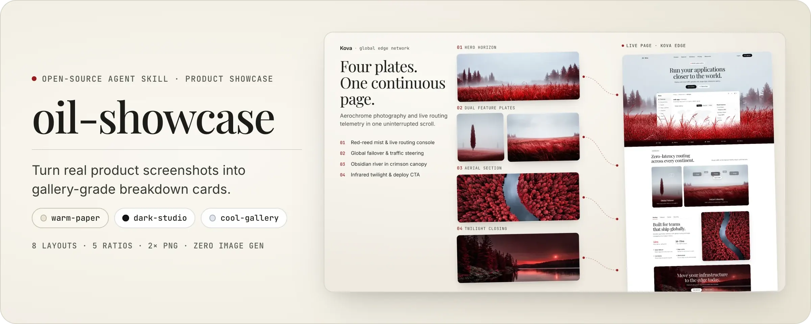
</p>

# oil-showcase

Turn real product screenshots—websites, matte dark desktop workbenches, native tools, and mobile apps—into restrained, `@2x` **Product Showcase Cards** for launches, READMEs, and social posts. Rendered locally with HTML/CSS, bundled SIL OFL fonts, and headless Chrome; zero AI image-generation APIs, zero configuration, and zero API keys.

**Deliverables:** `@2x` PNG cards (`png/*.png`), standalone HTML files (`html/*.html`), and a theme-matched contact sheet (`index.html`).

**Quick install:** Ask your Agent `Please install https://github.com/oil-oil/oil-showcase` or run `npx skills add oil-oil/oil-showcase`.

---

## Showcase — All 8 Built-in Layouts

Every card below was rendered locally by `oil-showcase` from real **Oil Studio** and **Oil UI** captures across all 8 layouts and all 3 studio-lit neutral themes (`warm-paper`, `dark-studio`, `cool-gallery`). Detail-reading layouts stay strictly upright (`0°`) for razor-sharp UI text, paired with pure-code studio lighting, fine SVG grain, and behind-the-card occluded typography.

<p align="center">
  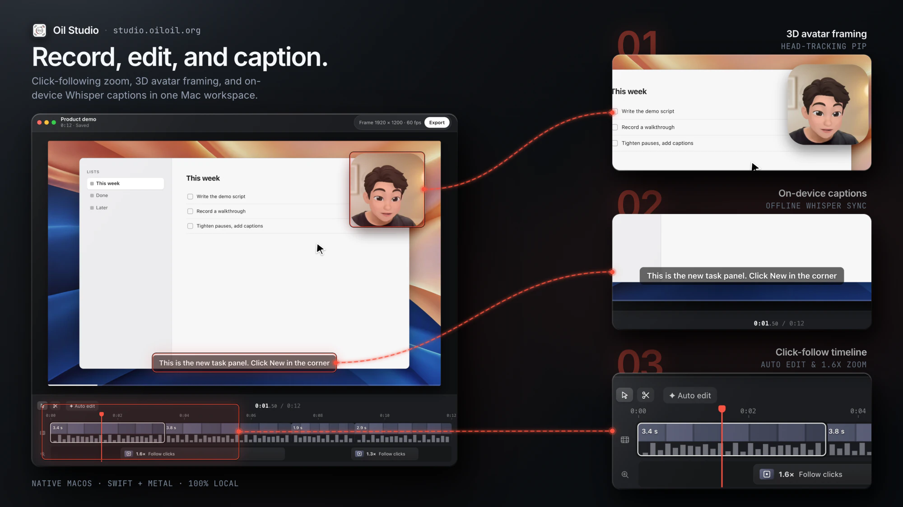
</p>
<p align="center">
  <sub><code>dark-studio</code> · <code>window-callout</code> · <code>16:9</code> — Upright Oil Studio workspace with occluded <code>01–03</code> callouts &amp; luminous leader lines</sub>
</p>

<table>
  <tr>
    <td width="50%" valign="top">
      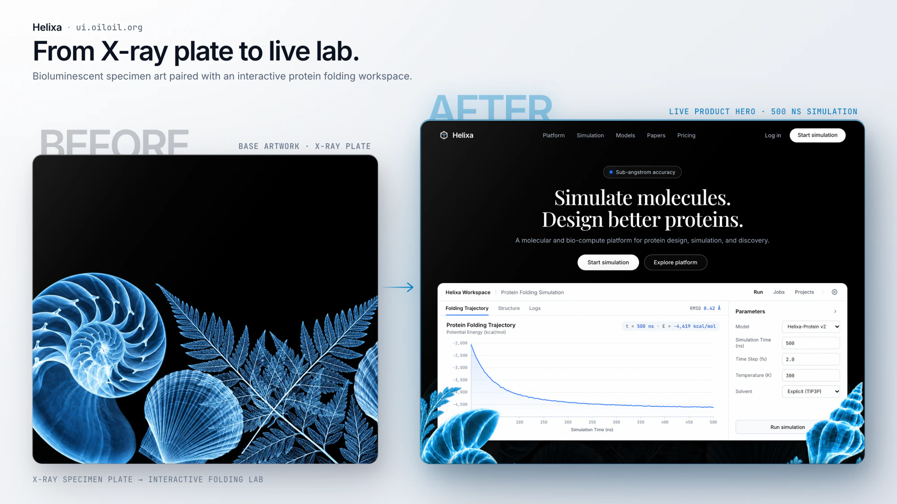
      <br><sub><code>cool-gallery</code> · <code>before-after</code> (side-by-side) · <code>16:9</code> — Asymmetric scale &amp; skylight contrast (Oil UI · Helixa)</sub>
    </td>
    <td width="50%" valign="top">
      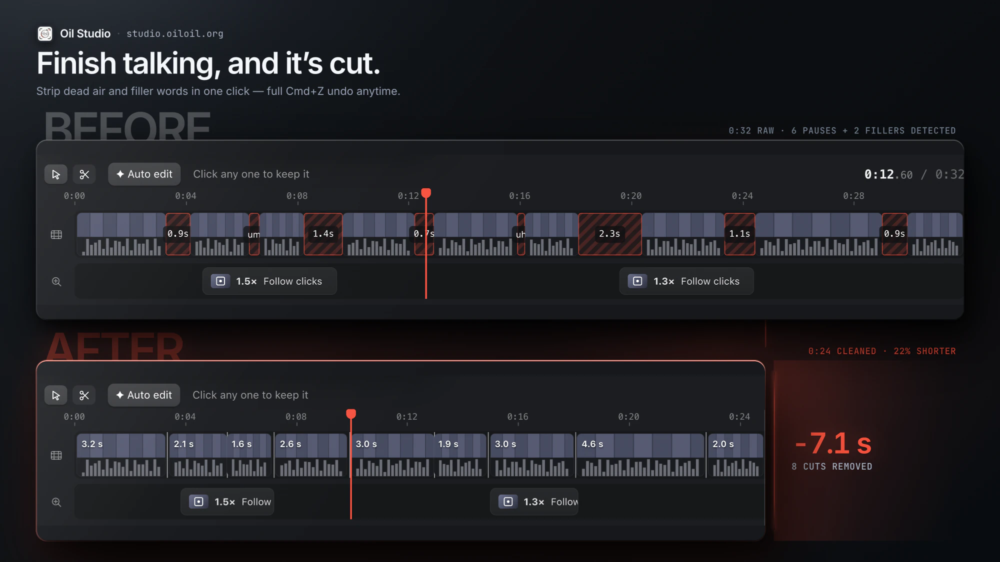
      <br><sub><code>dark-studio</code> · <code>before-after</code> (stacked) · <code>16:9</code> — Aligned timeline trim with optical hairline (Oil Studio)</sub>
    </td>
  </tr>
  <tr>
    <td width="50%" valign="top">
      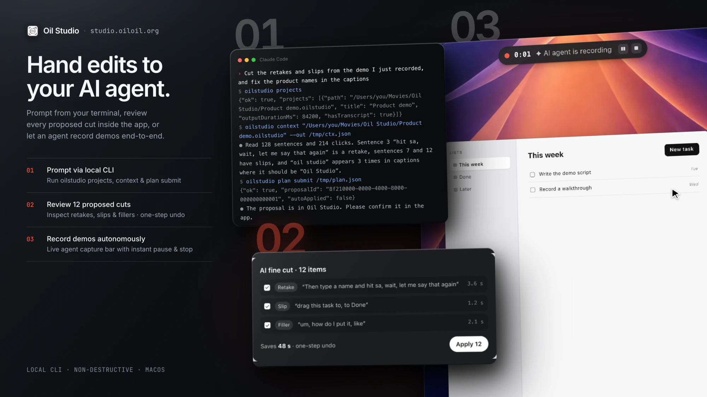
      <br><sub><code>dark-studio</code> · <code>workflow-steps</code> (<code>staged</code>) · <code>16:9</code> — Asymmetric 3D stage &amp; milestone rail (Oil Studio)</sub>
    </td>
    <td width="50%" valign="top">
      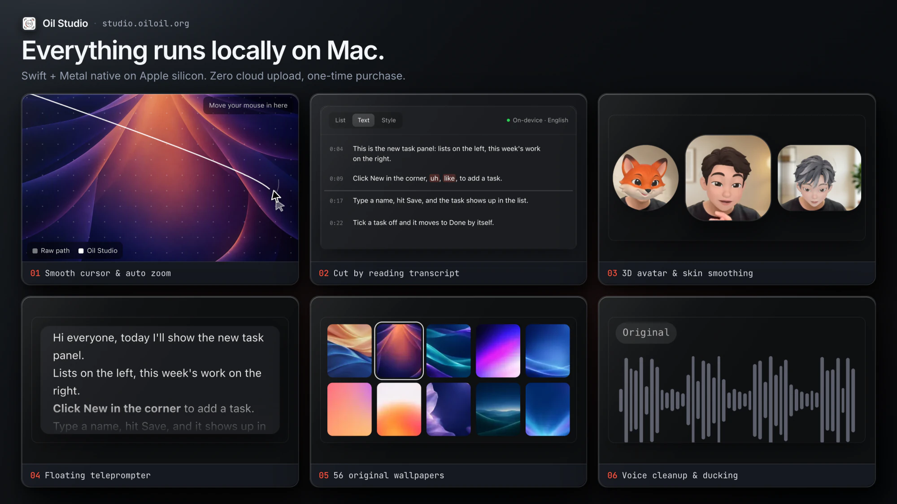
      <br><sub><code>dark-studio</code> · <code>module-bento</code> · <code>16:9</code> — Ordered 3×2 local feature grid (Oil Studio)</sub>
    </td>
  </tr>
  <tr>
    <td width="50%" valign="top">
      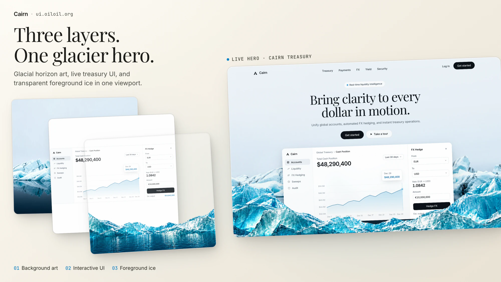
      <br><sub><code>warm-paper</code> · <code>layered-hero</code> · <code>16:9</code> — Three-layer stack &amp; live hero (Oil UI · Cairn)</sub>
    </td>
    <td width="50%" valign="top">
      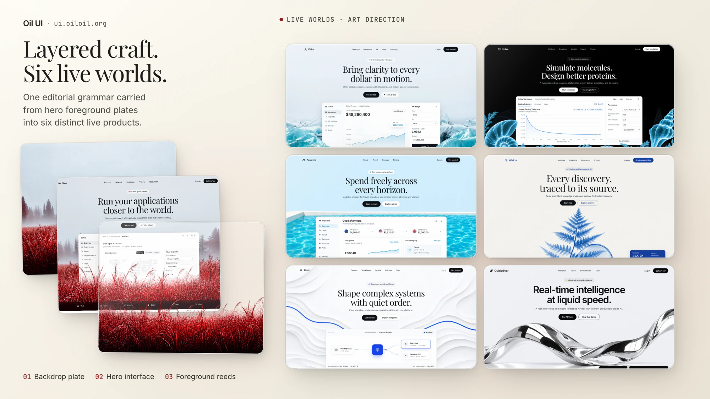
      <br><sub><code>warm-paper</code> · <code>layered-bento</code> · <code>16:9</code> — Layered stack paired with 6-tile Bento (Oil UI)</sub>
    </td>
  </tr>
  <tr>
    <td width="50%" valign="top">
      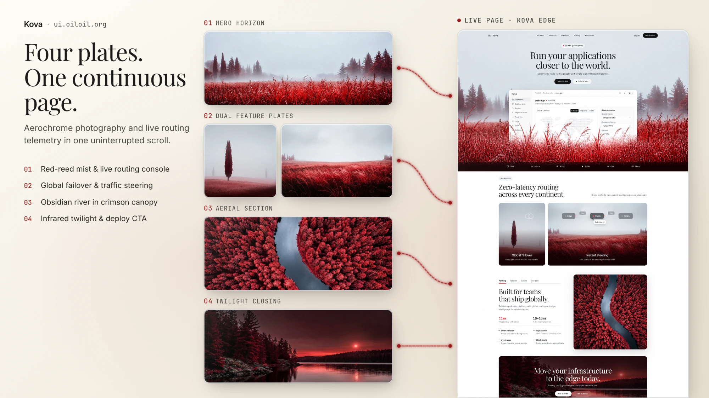
      <br><sub><code>warm-paper</code> · <code>section-assembly</code> · <code>16:9</code> — Ordered plates mapped to full page (Oil UI · Kova)</sub>
    </td>
    <td width="50%" valign="top">
      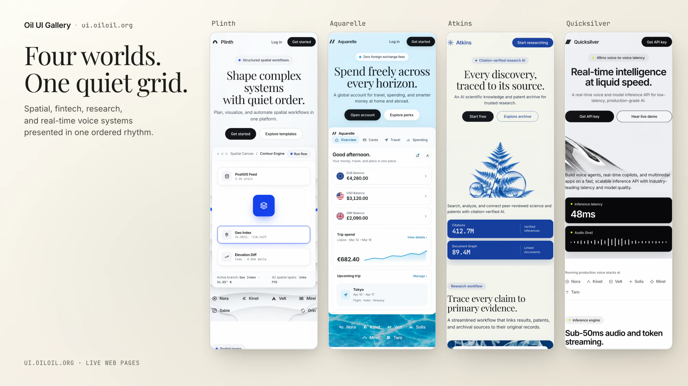
      <br><sub><code>warm-paper</code> · <code>gallery-wall</code> · <code>16:9</code> — Strictly ordered multi-world wall (Oil UI)</sub>
    </td>
  </tr>
</table>

### Adaptive Portrait Formats (`3:4` & `9:16`)

Vertical ratios reflow horizontal callouts into numbered anchors and stack comparisons vertically for mobile feeds and cover cards.

<p align="center">
  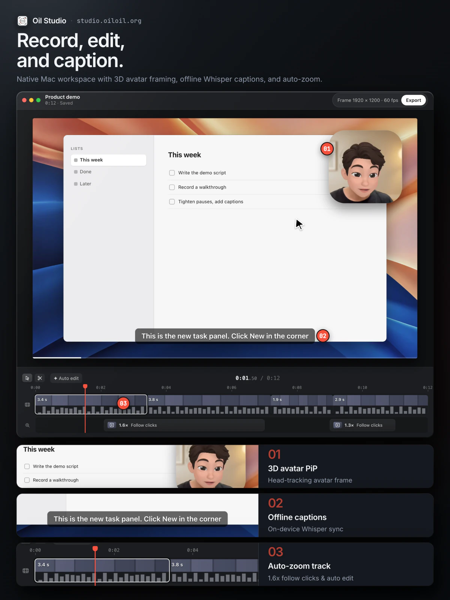
  &nbsp;&nbsp;&nbsp;
  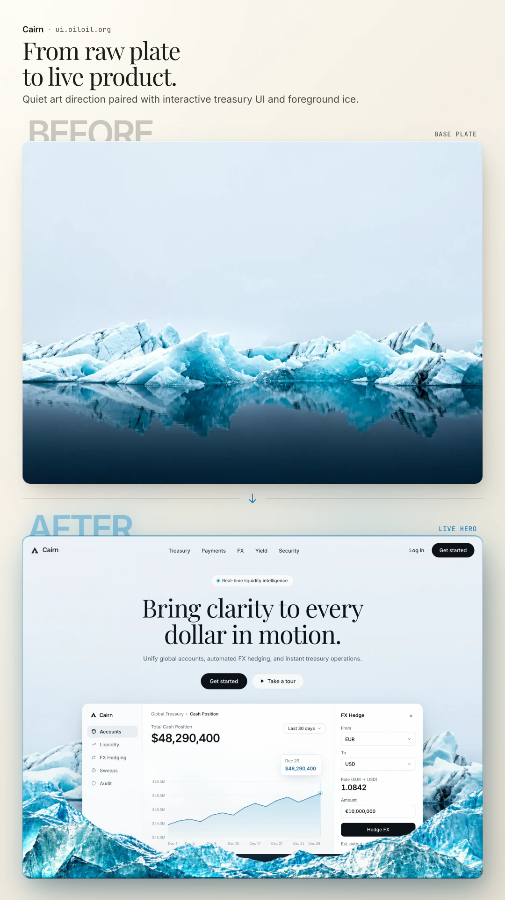
</p>
<p align="center">
  <sub>Left: <code>dark-studio</code> · <code>window-callout</code> · <code>3:4</code> (Oil Studio) &nbsp;|&nbsp; Right: <code>warm-paper</code> · <code>before-after</code> · <code>9:16</code> (Oil UI · Cairn)</sub>
</p>

---

## How It Works

<p align="center">
  
</p>

- **Pixel-exact UI:** Real screenshots stay untouched—no hallucinated buttons, distorted icons, or garbled text.
- **Repeatable edits:** Swap themes, adjust copy, or re-render one card (`--only <card-id>`) in seconds while keeping the rest of the set intact.
- **Built-in checks:** Verifies image decoding, bundled OFL font loading, and text overflow before writing PNGs.
- **Language-aware copy:** Card titles, labels, and default `before`/`after` badges follow your conversation language automatically.

---

## Install & Quick Start

**No configuration, login, or API keys required.**

### 1. Let your Agent install it (recommended)

```text
Please install this Skill: https://github.com/oil-oil/oil-showcase
```

### 2. Install via CLI

```bash
npx skills add oil-oil/oil-showcase
```

> `npx` is only an optional install shortcut; Node.js is not required at runtime. You can also copy `skills/oil-showcase/` into your Agent host's skills directory.

### Ask in Plain Language

- *"Turn these 4 screenshots of my desktop app into a `dark-studio` `window-callout` card at 16:9."*
- *"Build a 3:4 portrait showcase set in `warm-paper`, including a before-and-after comparison."*
- *"Capture `http://localhost:3000` without browser chrome, then render a `section-assembly` breakdown."*
- *"Switch card 02 to `cool-gallery` and shorten the subtitle without re-rendering the other cards."*

Full Agent instructions and JSON spec fields: [SKILL.md](./skills/oil-showcase/SKILL.md) and [references/design-system.md](./skills/oil-showcase/references/design-system.md).

---

## Themes, Layouts & Ratios

| Dimension | Options |
| --- | --- |
| **3 Studio-Lit Themes** | `warm-paper` (cotton matte serif default), `dark-studio` (anodized dark sans), `cool-gallery` (architectural light gray sans). Built-in directional key light, inline SVG grain, specular rim highlights, and restrained `accent` injection. |
| **8 Built-in Layouts** | `window-callout` (`split` / `stacked`), `before-after` (`side-by-side` / `stacked` + optical trim hairline), `workflow-steps` (`row` / `staged`), `layered-hero`, `layered-bento`, `section-assembly`, `module-bento`, `gallery-wall`. Upright `0°` by default on detail-reading layouts (`tilt` opt-in). |
| **5 Aspect Ratios** | `16:9` (`3200×1800` @2x), `4:3` (`2880×2160`), `3:4` (`2160×2880`), `9:16` (`2160×3840`), `1:1` (`2400×2400`), plus custom `WxH` viewports (`400–4000` CSS px). |

---

## Scope & Related Standalone Skills

| Need | Skill |
| --- | --- |
| Launch cards, social breakdown sets, Bento overviews, window callouts, before/after & workflow cards | **`oil-showcase`** (this repo) |
| GitHub README homepage redesign, hero banners, and SVG/WebP assets | [`beautify-github-readme`](https://github.com/oil-oil/beautify-github-readme) *(standalone)* |
| Designing or implementing production frontend interfaces | [`oil-ui`](https://github.com/oil-oil/oil-ui) *(standalone)* |
| Multi-slide decks (`oil-ppt`), long-form publishing (`oil-post`), ink-line concept art (`oil-visual`) | Standalone skills for slides, articles, and editorial illustration |

---

## Requirements & Direct CLI

Requires **Python 3.10+** (standard library only) and a local **Chrome, Chromium, or Microsoft Edge** installation (`CHROME_PATH` override supported). Bundled SIL OFL fonts (`Inter`, `Playfair Display`, `JetBrains Mono`) live in `skills/oil-showcase/assets/fonts/`.

```bash
# 1. Check Python, local browser, and bundled fonts (Windows: py -3)
python3 skills/oil-showcase/scripts/render_cards.py doctor

# 2. Optional: capture a clean frameless screenshot from local HTML or localhost
python3 skills/oil-showcase/scripts/render_cards.py capture ./demo/index.html --out ./shots/hero.png --viewport 1440x900 --scale 2

# 3. Render a spec file into @2x PNGs, standalone HTML, and contact sheet
python3 skills/oil-showcase/scripts/render_cards.py render ./cards.spec.json --out-dir ./out --scale 2

# 4. Re-render one card while preserving existing cards in index.html
python3 skills/oil-showcase/scripts/render_cards.py render ./cards.spec.json --out-dir ./out --only 01-window-callout --scale 2

# 5. Export a custom HTML card directly
python3 skills/oil-showcase/scripts/render_cards.py shoot ./custom-card.html --out ./out/custom.png --ratio 16:9 --scale 2

# 6. Run the regression test suite
python3 -W error -m unittest discover -s skills/oil-showcase/tests -v
```

- **Browser not detected:** Install Chrome, Chromium, or Edge, or set `CHROME_PATH="/path/to/browser"`.
- **Overflow warnings:** Shorten titles/captions or switch aspect ratio; clipped text and failed images are reported in the JSON output.

### Data, Privacy & Permissions

- **Local files only:** Reads only the spec JSON, local screenshots/HTML you pass, and bundled fonts; writes outputs strictly under `--out-dir` or `--out` (refusing to overwrite input images).
- **No credentials or telemetry:** Requires no login, API keys, or analytics, and does not access browser profiles or credential stores.

---

## License

Code and documentation are released under the [MIT License](./LICENSE). Bundled fonts in `skills/oil-showcase/assets/fonts/` are distributed under the [SIL Open Font License 1.1](./skills/oil-showcase/assets/fonts/OFL.txt); see [THIRD-PARTY-NOTICES.txt](./skills/oil-showcase/assets/fonts/THIRD-PARTY-NOTICES.txt) for per-font copyright notices and upstream sources.
