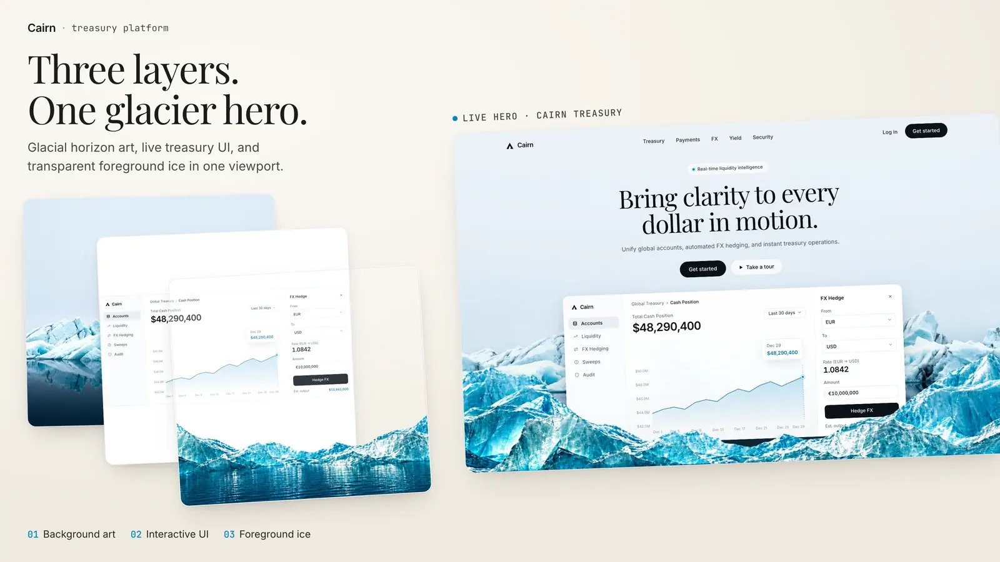
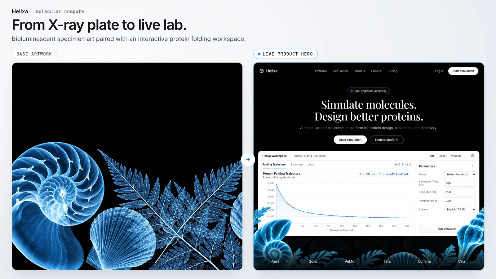

<p align="right">
  <strong>English</strong> · <a href="./README.zh-CN.md">简体中文</a>
</p>

<p align="center">
  
</p>

# oil-showcase

Turn real product screenshots—websites, matte dark desktop workbenches, native tools, and mobile apps—into restrained, `@2x` **Product Showcase Cards** for launches, READMEs, and social posts. Rendered locally with HTML/CSS and headless Chrome; zero image generation, zero configuration, and zero API keys.

**Deliverables:** High-resolution `@2x` PNG cards (`png/*.png`), standalone HTML files (`html/*.html`), and a theme-matched offline contact sheet (`index.html`).

**Quick install:** Ask your Agent `Please install https://github.com/oil-oil/oil-showcase` or run `npx skills add oil-oil/oil-showcase`.

---

## Showcase

Every card below was rendered locally from real UI captures by `oil-showcase` across its three neutral board themes (`warm-paper`, `dark-studio`, `cool-gallery`).

<p align="center">
  
</p>
<p align="center">
  <sub><code>dark-studio</code> · <code>window-callout</code> · <code>16:9</code> — Matte dark surface removes white framing around dark desktop tools</sub>
</p>

<table>
  <tr>
    <td width="50%" valign="top">
      
      <br><sub><code>warm-paper</code> · <code>layered-hero</code> · <code>16:9</code> — Layered stack &amp; live hero</sub>
    </td>
    <td width="50%" valign="top">
      
      <br><sub><code>cool-gallery</code> · <code>before-after</code> · <code>16:9</code> — Raw X-ray plate to live product hero</sub>
    </td>
  </tr>
  <tr>
    <td width="50%" valign="top">
      
      <br><sub><code>warm-paper</code> · <code>section-assembly</code> · <code>16:9</code> — Plates mapped to full page</sub>
    </td>
    <td width="50%" valign="top">
      
      <br><sub><code>cool-gallery</code> · <code>workflow-steps</code> · <code>16:9</code> — Multi-screen flow strip</sub>
    </td>
  </tr>
</table>

### Adaptive Portrait Formats (`3:4` & `9:16`)

Vertical ratios automatically reflow horizontal callouts into numbered anchors and stack comparisons vertically for mobile feeds and cover cards.

<p align="center">
  
  &nbsp;&nbsp;&nbsp;
  
</p>
<p align="center">
  <sub>Left: <code>dark-studio</code> · <code>window-callout</code> · <code>3:4</code> &nbsp;|&nbsp; Right: <code>warm-paper</code> · <code>before-after</code> · <code>9:16</code></sub>
</p>

---

## How It Works

<p align="center">
  
</p>

**Why HTML/CSS + local browser instead of AI image generation?**
- **Pixel-exact UI:** Your real screenshots stay untouched—no hallucinated buttons, distorted icons, or garbled interface text.
- **Deterministic layout & repeatable edits:** Change a title, swap a theme, or re-render one card (`--only <card-id>`) in seconds while preserving the rest of the set.
- **Built-in pre-flight checks:** Automatically verifies image decoding, bundled OFL font loading, and text overflow before writing PNGs.

---

## Install & Quick Start

**No configuration, login, or API keys required.** Install once and use offline.

### 1. Let your Agent install it (recommended)

Send your Agent the repository URL directly:

```text
Please install this Skill: https://github.com/oil-oil/oil-showcase
```

### 2. Install via CLI

```bash
npx skills add oil-oil/oil-showcase
```

> `npx` is only an optional install shortcut; Node.js is **not** required to run the Skill. You can also place this repository folder directly in your Agent host's skills directory.

### Usage in Plain Language

Once installed, ask your Agent naturally with your screenshots or local web page:

- *"Turn these 4 screenshots of my desktop app into a `dark-studio` `window-callout` card at 16:9."*
- *"Build a 3:4 portrait showcase set for social launch using `warm-paper`, with a before-and-after comparison card."*
- *"Capture `http://localhost:3000` cleanly without browser chrome, then render a `section-assembly` breakdown."*
- *"Switch card 02 to `cool-gallery` and shorten the subtitle without re-rendering the other cards."*

For full Agent instructions and JSON spec fields, see [SKILL.md](./SKILL.md) and [references/design-system.md](./references/design-system.md).

---

## Themes, Layouts & Ratios

| Dimension | Available Options |
| --- | --- |
| **3 Neutral Themes** | `warm-paper` (editorial serif default), `dark-studio` (matte dark sans for dark desktop tools), `cool-gallery` (architectural light gray sans). Any theme supports `displayStyle` (`"serif"` or `"sans"`) override and restrained `accent` hex injection. |
| **8 Built-in Layouts** | `layered-hero`, `layered-bento`, `section-assembly`, `module-bento`, `gallery-wall` (`tilted-pages` / `collage`), `window-callout`, `before-after`, `workflow-steps`. Custom HTML cards can also be exported via `shoot`. |
| **5 Aspect Ratios** | `16:9` (`3200×1800` @2x), `4:3` (`2880×2160`), `3:4` (`2160×2880`), `9:16` (`2160×3840`), `1:1` (`2400×2400`), plus custom `WxH` viewports (`400–4000` CSS px). |

---

## Scope & Adjacent Skills

| Need | Use |
| --- | --- |
| Launch cards, social breakdown sets, Bento overviews, before/after & workflow cards from real UI | **`oil-showcase`** |
| Multi-slide 16:9 or 9:16 presentation decks and PPTX export | `oil-ppt` |
| Long-form articles, release notes, and social post publishing | `oil-post` |
| Conceptual ink-line illustrations and editorial spot art | `oil-visual` |
| Designing or implementing production frontend interfaces | `oil-ui-pro` |

---

## Compatibility, Privacy & Local Verification

### Environment & Platform Support

| Item | Details |
| --- | --- |
| **Runtime** | Python 3.10+ standard library only (zero third-party Python or Node dependencies) |
| **Browser** | Local Google Chrome, Chromium, or Microsoft Edge in headless mode (`CHROME_PATH` override supported) |
| **Offline Fonts** | Bundled SIL OFL fonts (`Inter`, `Playfair Display`, `JetBrains Mono`) under `assets/fonts/` |
| **Platforms** | **macOS**: verified on hardware. **Windows & Linux**: cross-platform paths and browser discovery implemented, pending native machine verification |
| **Host Capabilities** | Works in any Agent host that can execute local Python commands; hosts with vision support can also visually inspect exported PNGs |

### Data Boundary & Privacy

- **100% local execution:** Screenshots, copy, and spec JSON files are processed strictly on your machine and never uploaded to any external server.
- **No telemetry or secrets:** No analytics, no remote font requests, no login, and no credential files read or written.

### Direct CLI, Tests & Troubleshooting

```bash
# 1. Verify Python, local Chrome/Edge, and bundled OFL fonts
python3 scripts/render_cards.py doctor          # Windows: py -3 scripts/render_cards.py doctor

# 2. Optional: capture a clean frameless screenshot from local HTML or localhost
python3 scripts/render_cards.py capture ./demo/index.html --out ./shots/hero.png --viewport 1440x900 --scale 2

# 3. Render a spec file into @2x PNGs, standalone HTML, and offline index.html
python3 scripts/render_cards.py render ./cards.spec.json --out-dir ./out --scale 2

# 4. Re-render a single card while keeping existing cards in index.html
python3 scripts/render_cards.py render ./cards.spec.json --out-dir ./out --only 01-window-callout --scale 2

# 5. Export a custom HTML card directly
python3 scripts/render_cards.py shoot ./custom-card.html --out ./out/custom.png --ratio 16:9 --scale 2

# 6. Run the local regression test suite
python3 -W error -m unittest discover -s tests -v
```

**Troubleshooting:**
- **Browser not detected:** Install Chrome, Chromium, or Microsoft Edge, or export `CHROME_PATH="/path/to/browser"` before running `doctor`.
- **Overflow warnings in output:** Shorten titles/captions or switch aspect ratio; the renderer reports clipped text and unrendered images directly in its JSON output.

---

## License

Code and documentation are released under the [MIT License](./LICENSE). Bundled fonts in `assets/fonts/` remain under their respective SIL Open Font License (OFL) terms.
