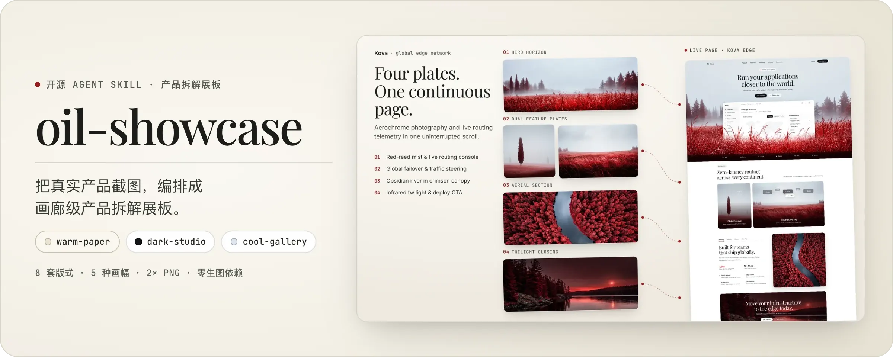
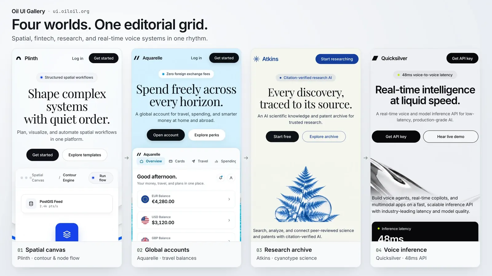
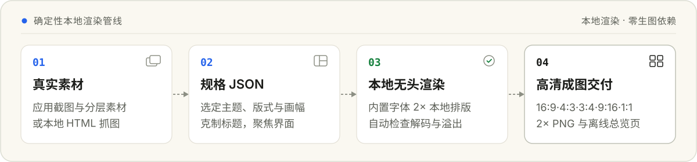

<p align="right">
  <a href="./README.md">English</a> · <strong>简体中文</strong>
</p>

<p align="center">
  
</p>

# oil-showcase

用克制的画廊编辑风，将真实产品截图（网站、深色桌面工作台、原生工具、移动 App）编排为 `@2x` 高分辨率**产品演示展板**，直接用于产品发布、README 与社媒展示。全程通过本地 HTML/CSS 与无头浏览器渲染，零生图依赖、无需配置、无需 API Key。

**交付产物：** 高清 `@2x` PNG 卡片（`png/*.png`）、独立单卡 HTML（`html/*.html`）以及与主题一致的离线总览页（`index.html`）。

**快速安装：** 直接发给 Agent「请安装 `https://github.com/oil-oil/oil-showcase`」，或运行 `npx skills add oil-oil/oil-showcase`。

---

## 真实产出示例

以下卡片均由 `oil-showcase` 基于真实界面截图在本地直接渲染，覆盖三套中性画板主题（`warm-paper`、`dark-studio`、`cool-gallery`）。

<p align="center">
  
</p>
<p align="center">
  <sub><code>dark-studio</code> · <code>window-callout</code> · <code>16:9</code> — 暗棚哑光底板专为深色桌面工作台消除截图白边</sub>
</p>

<table>
  <tr>
    <td width="50%" valign="top">
      
      <br><sub><code>warm-paper</code> · <code>layered-hero</code> · <code>16:9</code> — 暖纸分层主视觉</sub>
    </td>
    <td width="50%" valign="top">
      
      <br><sub><code>cool-gallery</code> · <code>before-after</code> · <code>16:9</code> — 原始底图到完整产品首屏对比</sub>
    </td>
  </tr>
  <tr>
    <td width="50%" valign="top">
      
      <br><sub><code>warm-paper</code> · <code>section-assembly</code> · <code>16:9</code> — 暖纸页面切片拆解</sub>
    </td>
    <td width="50%" valign="top">
      
      <br><sub><code>cool-gallery</code> · <code>workflow-steps</code> · <code>16:9</code> — 冷灰四屏流程串联</sub>
    </td>
  </tr>
</table>

### 竖屏比例自适应（`3:4` 与 `9:16`）

切换到竖屏画幅时，横向标注会自动转为高对比数字定位针，双栏对比自动切换为上下堆叠，直接适配小红书、视频号封面与移动端图文。

<p align="center">
  
  &nbsp;&nbsp;&nbsp;
  
</p>
<p align="center">
  <sub>左：<code>dark-studio</code> · <code>window-callout</code> · <code>3:4</code> &nbsp;|&nbsp; 右：<code>warm-paper</code> · <code>before-after</code> · <code>9:16</code></sub>
</p>

---

## 工作原理

<p align="center">
  
</p>

**为什么用本地 HTML/CSS 排版，而不是 AI 生图？**
- **界面像素零失真**：直接使用你的真实产品截图，不会出现按钮变形、图标错乱或界面文字乱码。
- **确定性布局与秒级微调**：改标题、换画板主题或单卡精修（`--only <card-id>`）只需几秒，其余卡片与总览页原样保留。
- **渲染前自动体检**：内置脚本会在导出前校验图片解码、内置 OFL 字体加载状态与文本是否溢出。

---

## 安装与配置

本 Skill **无需额外配置、无需登录、无需任何 API Key**，安装后即可离线运行。

### 1. 让 Agent 自动安装（推荐）

直接把仓库地址发给你的 Agent：

```text
请帮我安装这个 Skill：https://github.com/oil-oil/oil-showcase
```

### 2. 使用命令安装

```bash
npx skills add oil-oil/oil-showcase
```

> `npx` 仅用于可选的快捷安装，Node.js **不是**本 Skill 的运行依赖。你也可以直接将仓库目录放到 Agent 宿主的 Skill 目录中启用。

### 自然语言触发示例

安装后，直接提供截图路径或本地页面地址即可让 Agent 制作展板：

- “把这 4 张桌面端截图做成一张 16:9 的 `dark-studio` 窗口标注拆解卡。”
- “用 `warm-paper` 主题做一套 3:4 竖屏发布图，包含一张改版前后对比卡。”
- “先无边框截取 `http://localhost:3000` 的整页，再生成一张 `section-assembly` 结构拆解图。”
- “把第 2 张卡片切到 `cool-gallery` 主题并精简副标题，其他卡片不要重渲染。”

完整 Agent 执行流程与 `spec.json` 字段说明见 [SKILL.md](./SKILL.md) 与 [设计系统参考](./references/design-system.md)。

---

## 主题、版式与画幅一览

| 维度 | 支持选项 |
| --- | --- |
| **3 套中性画板主题** | `warm-paper`（暖纸衬线编辑风，默认）、`dark-studio`（暗棚哑光无衬线，适配深色专业工具）、`cool-gallery`（冷灰建筑感无衬线）。三套均支持通过 `displayStyle`（`"serif"` 或 `"sans"`）覆盖标题字体，并克制注入产品 `accent` 主题色。 |
| **8 种内置版式** | `layered-hero`、`layered-bento`、`section-assembly`、`module-bento`、`gallery-wall`（`tilted-pages` / `collage`）、`window-callout`、`before-after`、`workflow-steps`；超出内置版式时可通过 `shoot` 导出自定义 HTML 单卡。 |
| **5 种预设画幅** | `16:9`（`@2x` 为 `3200×1800`）、`4:3`（`2880×2160`）、`3:4`（`2160×2880`）、`9:16`（`2160×3840`）、`1:1`（`2400×2400`），并支持 `400–4000` 范围内的自定义 `WxH` 像素视口。 |

---

## 适用边界与相邻 Skill

| 需求场景 | 推荐使用 |
| --- | --- |
| 产品发布配图、社媒展示卡、竖屏封面、Bento 模块总览、窗口标注、前后对比与流程拆解 | **`oil-showcase`** |
| 多页 16:9 / 9:16 HTML 演示文稿与 PPTX 导出 | `oil-ppt` |
| 长图文撰写、排版与社交平台草稿发布 | `oil-post` |
| 统一漫画墨线风格的概念与机制解释图 | `oil-visual` |
| 线上产品网站、App 或后台界面的 UI/UX 设计与编码 | `oil-ui-pro` |

---

## 兼容性、数据边界与本地验证

### 运行环境与平台支持

| 项目 | 说明 |
| --- | --- |
| **运行时** | 仅依赖 Python 3.10+ 标准库，无任何第三方 Python / Node 包依赖 |
| **浏览器** | 本机已安装的 Chrome、Chromium 或 Microsoft Edge 无头模式（支持 `CHROME_PATH` 指定路径） |
| **离线字体** | 随仓内置开源 SIL OFL 字体（`Inter`、`Playfair Display`、`JetBrains Mono`），位于 `assets/fonts/` |
| **平台状态** | **macOS**：已实机验证；**Windows / Linux**：已完成跨平台路径与浏览器发现兼容，待实机验证 |
| **宿主能力** | 任何支持执行本地 Python 命令的 Agent 宿主均可运行；具备读图能力的宿主可在交付前自动抽查成图 |

### 数据边界与隐私

- **100% 本地处理**：截图、文案与规格 JSON 全程在本机完成排版与渲染，不向任何外部服务器上传数据。
- **零遥测、零凭据**：不请求外网字体或统计接口，不登录账号，不读取或写入用户凭据目录。

### 命令行工具、测试与排障

```bash
# 1. 检查 Python、本机浏览器与内置 OFL 字体是否就绪（Windows 使用 py -3）
python3 scripts/render_cards.py doctor

# 2. 按需从本地 HTML 或 localhost 抓取无浏览器边框的高清截图
python3 scripts/render_cards.py capture ./demo/index.html --out ./shots/hero.png --viewport 1440x900 --scale 2

# 3. 按规格 JSON 批量渲染 @2x PNG、单卡 HTML 与离线总览页
python3 scripts/render_cards.py render ./cards.spec.json --out-dir ./out --scale 2

# 4. 仅局部重渲染单张卡片，保留同目录已有卡片与总览页
python3 scripts/render_cards.py render ./cards.spec.json --out-dir ./out --only 01-window-callout --scale 2

# 5. 直接导出自定义 HTML 单卡
python3 scripts/render_cards.py shoot ./custom-card.html --out ./out/custom.png --ratio 16:9 --scale 2

# 6. 运行本地回归测试套件
python3 -W error -m unittest discover -s tests -v
```

**常见问题排查：**
- **未检测到浏览器**：安装 Chrome、Chromium 或 Microsoft Edge，或在运行前设置环境变量 `CHROME_PATH` 指向浏览器可执行文件。
- **输出包含文本溢出警告**：缩短标题或副标题，或调整画幅比例；渲染脚本会在输出的 JSON 中标出具体卡片的溢出或图片解码异常。

---

## 许可

代码与文档采用 [MIT License](./LICENSE)；`assets/fonts/` 目录下的内置字体沿用各自开源 SIL Open Font License (OFL) 许可。
