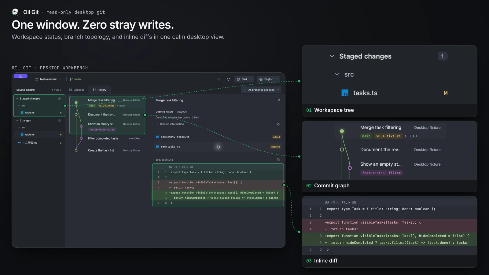
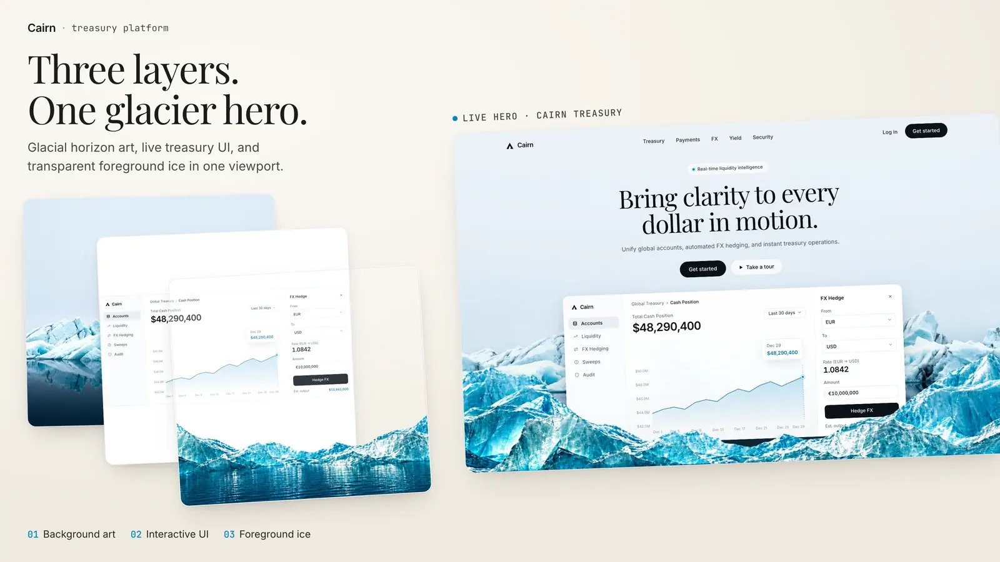
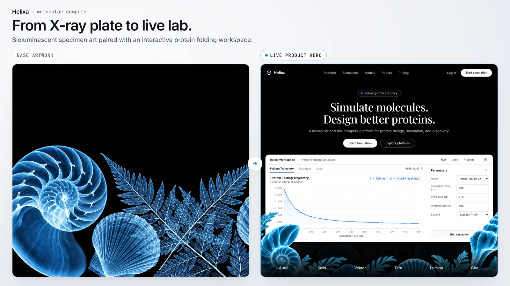
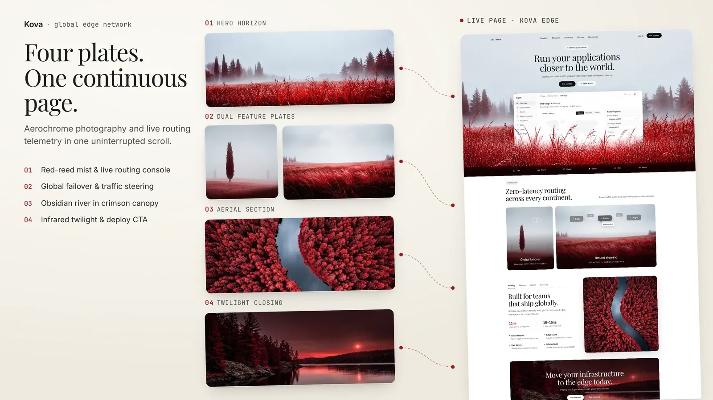
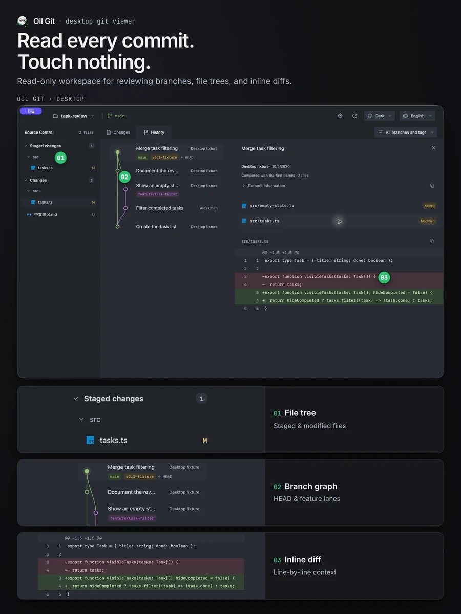
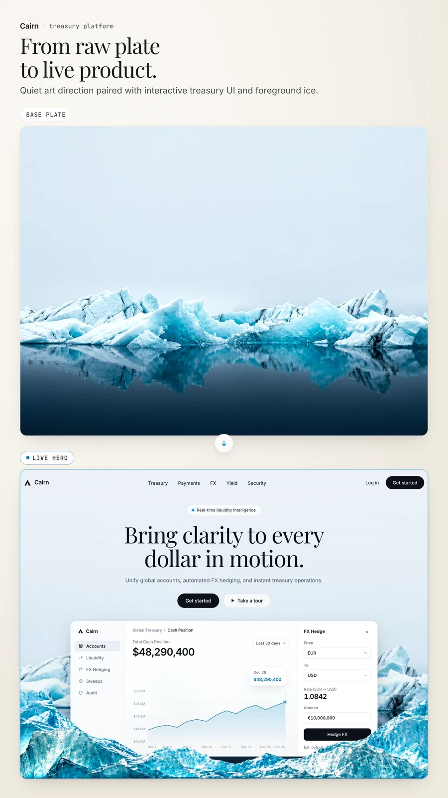

<p align="right">
  <a href="./README.md">English</a> · <strong>简体中文</strong>
</p>

<p align="center">
  
</p>

# oil-showcase

用克制的画廊编辑风，将真实产品截图（网站、深色桌面工作台、原生工具、移动 App）编排为 `@2x` 高分辨率**产品演示展板**，直接用于产品发布、README 与社媒展示。全程通过本地 HTML/CSS、内置 SIL OFL 字体与无头浏览器渲染，零 AI 生图 API、无需配置、无需 API Key。

**交付产物：** `@2x` 高清 PNG 卡片（`png/*.png`）、独立单卡 HTML（`html/*.html`）以及主题匹配的总览页（`index.html`）。

**快速安装：** 直接发给 Agent「请安装 `https://github.com/oil-oil/oil-showcase`」，或运行 `npx skills add oil-oil/oil-showcase`。

---

## 真实产出示例

以下卡片均由 `oil-showcase` 基于真实界面截图在本地直接渲染，覆盖三套中性画板主题（`warm-paper`、`dark-studio`、`cool-gallery`）。

<p align="center">
  
</p>
<p align="center">
  <sub><code>dark-studio</code> · <code>window-callout</code> · <code>16:9</code> — 暗棚哑光底板专为深色桌面工作台消除截图白边</sub>
</p>

<table>
  <tr>
    <td width="50%" valign="top">
      
      <br><sub><code>warm-paper</code> · <code>layered-hero</code> · <code>16:9</code> — 暖纸分层主视觉</sub>
    </td>
    <td width="50%" valign="top">
      
      <br><sub><code>cool-gallery</code> · <code>before-after</code> · <code>16:9</code> — 原始底图到完整产品首屏对比</sub>
    </td>
  </tr>
  <tr>
    <td width="50%" valign="top">
      
      <br><sub><code>warm-paper</code> · <code>section-assembly</code> · <code>16:9</code> — 暖纸页面切片拆解</sub>
    </td>
    <td width="50%" valign="top">
      
      <br><sub><code>cool-gallery</code> · <code>workflow-steps</code> · <code>16:9</code> — 冷灰四屏流程串联</sub>
    </td>
  </tr>
</table>

### 竖屏比例自适应（`3:4` 与 `9:16`）

切换到竖屏画幅时，横向标注会自动转为高对比数字定位针，双栏对比自动切换为上下堆叠，直接适配小红书、视频号封面与移动端图文。

<p align="center">
  
  &nbsp;&nbsp;&nbsp;
  
</p>
<p align="center">
  <sub>左：<code>dark-studio</code> · <code>window-callout</code> · <code>3:4</code> &nbsp;|&nbsp; 右：<code>warm-paper</code> · <code>before-after</code> · <code>9:16</code></sub>
</p>

---

## 工作原理

<p align="center">
  
</p>

- **界面像素零失真**：直接使用真实产品截图，不会出现按钮变形、图标错乱或界面文字乱码。
- **确定性排版与秒级微调**：改标题、换主题或单卡精修（`--only <card-id>`）只需几秒，其余卡片与总览页原样保留。
- **渲染前自动体检**：导出前自动检查图片解码、内置 OFL 字体加载与文本溢出。
- **语言跟随对话**：卡片标题、标注文案以及 `before-after` 默认标签均随当前对话语言自动适配。

---

## 安装与上手

**无需额外配置、无需登录、无需 API Key。**

### 1. 让 Agent 自动安装（推荐）

```text
请帮我安装这个 Skill：https://github.com/oil-oil/oil-showcase
```

### 2. 使用命令安装

```bash
npx skills add oil-oil/oil-showcase
```

> `npx` 仅作为快捷安装方式，运行时不依赖 Node.js。也可以直接将 `skills/oil-showcase/` 放入 Agent 宿主的 Skill 目录。

### 自然语言示例

- “把这 4 张桌面端截图做成一张 16:9 的 `dark-studio` 窗口标注拆解卡。”
- “用 `warm-paper` 主题做一套 3:4 竖屏发布图，包含一张改版前后对比卡。”
- “先无边框截取 `http://localhost:3000` 的整页，再生成一张 `section-assembly` 结构拆解图。”
- “把第 2 张卡片切到 `cool-gallery` 主题并精简副标题，其他卡片不要重渲染。”

完整 Agent 指令与 `spec.json` 字段见 [SKILL.md](./skills/oil-showcase/SKILL.md) 与 [设计系统参考](./skills/oil-showcase/references/design-system.md)。

---

## 主题、版式与画幅一览

| 维度 | 支持选项 |
| --- | --- |
| **3 套中性主题** | `warm-paper`（暖纸衬线，默认）、`dark-studio`（暗棚哑光无衬线）、`cool-gallery`（冷灰无衬线）。均支持 `displayStyle`（`"serif"` / `"sans"`）覆盖与克制的 `accent` 主题色注入。 |
| **8 种内置版式** | `layered-hero`、`layered-bento`、`section-assembly`、`module-bento`、`gallery-wall`（`tilted-pages` / `collage`）、`window-callout`、`before-after`、`workflow-steps`；自定义 HTML 单卡可通过 `shoot` 导出。 |
| **5 种预设画幅** | `16:9`（`@2x` `3200×1800`）、`4:3`（`2880×2160`）、`3:4`（`2160×2880`）、`9:16`（`2160×3840`）、`1:1`（`2400×2400`），并支持 `400–4000` 范围内的自定义 `WxH` 像素视口。 |

---

## 适用边界与相关独立 Skill

| 需求场景 | 对应 Skill |
| --- | --- |
| 产品发布配图、社媒展示卡、竖屏封面、Bento 模块总览、窗口标注、前后对比与流程拆解 | **`oil-showcase`**（本仓库） |
| GitHub README 主页视觉升级、头图与矢量/位图配图制作 | [`beautify-github-readme`](https://github.com/oil-oil/beautify-github-readme) *（独立 Skill）* |
| 线上产品网站、App 或后台界面的 UI/UX 设计与编码 | [`oil-ui`](https://github.com/oil-oil/oil-ui) *（独立 Skill）* |
| 多页演示文稿（`oil-ppt`）、长图文发布（`oil-post`）、漫画墨线概念图（`oil-visual`） | 各自独立的专用 Skill |

---

## 环境要求与命令行

仅依赖 **Python 3.10+** 标准库与本机已安装的 **Chrome、Chromium 或 Microsoft Edge**（支持 `CHROME_PATH` 指定路径），内置 SIL OFL 字体（`Inter`、`Playfair Display`、`JetBrains Mono`）位于 `skills/oil-showcase/assets/fonts/`。

```bash
# 1. 检查 Python、本机浏览器与内置字体（Windows 使用 py -3）
python3 skills/oil-showcase/scripts/render_cards.py doctor

# 2. 按需从本地 HTML 或 localhost 抓取无浏览器边框的高清截图
python3 skills/oil-showcase/scripts/render_cards.py capture ./demo/index.html --out ./shots/hero.png --viewport 1440x900 --scale 2

# 3. 按规格 JSON 批量渲染 @2x PNG、单卡 HTML 与总览页
python3 skills/oil-showcase/scripts/render_cards.py render ./cards.spec.json --out-dir ./out --scale 2

# 4. 仅局部重渲染单张卡片，保留同目录已有卡片与总览页
python3 skills/oil-showcase/scripts/render_cards.py render ./cards.spec.json --out-dir ./out --only 01-window-callout --scale 2

# 5. 直接导出自定义 HTML 单卡
python3 skills/oil-showcase/scripts/render_cards.py shoot ./custom-card.html --out ./out/custom.png --ratio 16:9 --scale 2

# 6. 运行回归测试套件
python3 -W error -m unittest discover -s skills/oil-showcase/tests -v
```

- **未检测到浏览器**：安装 Chrome、Chromium 或 Edge，或设置环境变量 `CHROME_PATH` 指向可执行文件。
- **文本溢出警告**：缩短标题或调整画幅比例；渲染脚本会在输出 JSON 中标出具体卡片的溢出或图片解码异常。

### 数据与权限边界

- **仅读写指定路径**：脚本只读取你提供的规格 JSON、截图/HTML 与内置字体，只向 `--out-dir` 或 `--out` 写入产物，并拒绝覆盖输入原图。
- **无凭据、无遥测**：不登录账号、不读取浏览器用户配置或凭据目录，也不上报任何统计数据。

---

## 许可

代码与文档采用 [MIT License](./LICENSE)；`skills/oil-showcase/assets/fonts/` 目录下的内置字体依据 [SIL Open Font License 1.1](./skills/oil-showcase/assets/fonts/OFL.txt) 分发，各字体版权声明与上游来源见 [THIRD-PARTY-NOTICES.txt](./skills/oil-showcase/assets/fonts/THIRD-PARTY-NOTICES.txt)。
